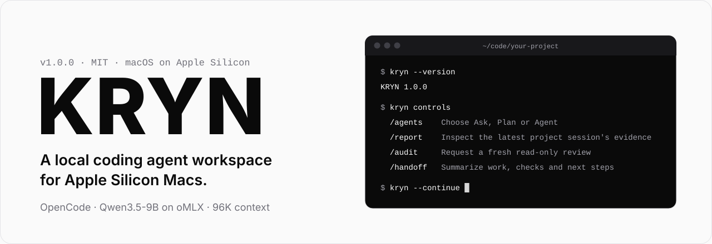
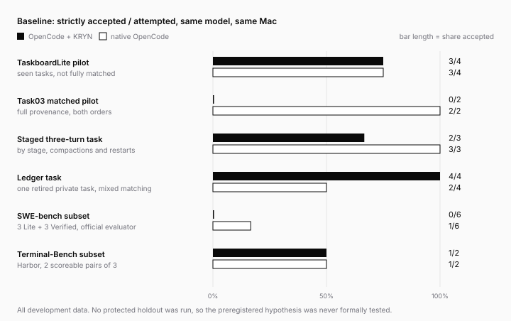
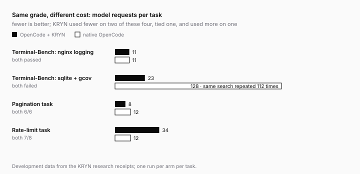
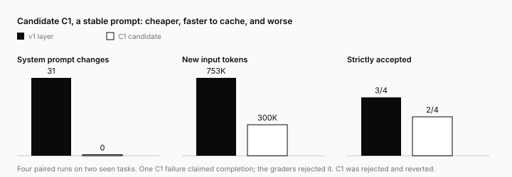

<div align="center">

<picture>
  <source media="(prefers-color-scheme: dark)" srcset="docs/assets/kryn-banner-dark.svg">
  
</picture>

<br>
<br>

[](https://github.com/PranavMishra28/kryn/actions/workflows/checks.yml)
[](https://github.com/PranavMishra28/kryn/releases/latest)
[](LICENSE)
[](#install)
[](https://github.com/PranavMishra28/kryn/discussions)

**[Install](#install)** · **[Quick start](#quick-start)** · **[How it works](#how-it-works)** · **[Benchmarks](#where-it-stands)** · **[Roadmap](ROADMAP.md)** · **[Contribute](#contributing)** · **[Case study](https://pranavmishra.app/case-studies/kryn)**

</div>

KRYN is a coding agent workspace that runs on one Mac. It puts [OpenCode](https://github.com/anomalyco/opencode)'s agent loop in front of a local [Qwen3.5-9B](https://huggingface.co/mlx-community/Qwen3.5-9B-6bit) served by [oMLX](https://github.com/jundot/omlx), then adds what a laptop you also use for everything else needs: a checksum-verified installer with rollback, a memory guard, session evidence that survives compaction and restarts, and recovery when something stops.

The goal is frontier-adjacent coding on a laptop. **v1.0.0 ships the part the release evidence proves today: supervised local coding.** You review changes and run checks; KRYN keeps the record of what actually happened. A preregistered [benchmark rig](#the-benchmark-rig) decides when it can claim more.

## Why KRYN

- **Local by default.** Inference runs on your Mac through oMLX on loopback. No paid provider is needed. Other OpenCode providers are opt-in from `/models`; search (Exa) and browser tools reach the network.
- **Safe on a shared laptop.** A 22 GiB inference ceiling and one heavyweight generation at a time. The resource guard stops only the session it owns on critical memory pressure, missing telemetry or swap growth, and `kryn --continue` resumes it.
- **Evidence over claims.** A continuity plugin checkpoints the request, file hashes and observed check exits. After compaction or a restart, unverified work stays marked unverified. `/report` shows what the session observed, not what the model said.
- **Installs you can undo.** Every asset is pinned by SHA-256, activation is transactional, `kryn rollback` restores the previous install, and `kryn doctor --deep` re-hashes the model and browser files.

## Quick start

Once installed, from your project folder:

```sh
cd "/absolute/path/to/your/project" && kryn
```

Type a request and press Enter. New sessions start in **Agent**.

| Do this | With |
|---|---|
| Choose Ask, Plan or Agent | `Ctrl+X` then `A` |
| Switch Default (bounded thinking) and Fast | `Ctrl+T` |
| Search every command | `Ctrl+P` |
| Pick a model or provider | `/models` |
| See what the session observed | `/report` |
| Run one bounded coding child | `/call TASK` |
| Resume a saved session | `/sessions` or `kryn --continue` |
| Open the browser GUI | `kryn --web`, then `/web` for its temporary credentials |
| Offline reference, no model needed | `kryn controls` |

Agent can delegate Explore, Browse or Reviewer work. Local generations run one at a time to protect memory. Review permission prompts and generated changes: explicit `kryn --auto` accepts every native request that is not denied, including browser and network actions (see [permission scope](docs/usage.md#models-and-providers)). Saved sessions stay on disk, and compaction summaries can be wrong.

## Install

The v1.0.0 installer fetches public release assets over HTTPS. No GitHub account is needed.

> [!WARNING]
> **Known issue in v1.0.0:** once Google Chrome updates past version 154, `kryn` stops at launch with "Chrome major differs from the tested compatibility lines". The fix (#256) is merged and ships in v1.0.1. Until then v1.0.0 only starts with Chrome 153 or 154.

**Requirements**

- Native Apple Silicon, macOS 26 or 27, and at least **48 GiB unified memory**. Release validation used an M4 Max with 48 GiB. Run the installer from the logged-in macOS account with its normal `HOME`; a `HOME` override cannot isolate the oMLX app.
- `python3` and `curl` in Terminal, and Google Chrome at `/Applications/Google Chrome.app`.
- Internet access during installation, and room for about **8.22 GB of model files**, dependencies, and the installer's **40 GiB free-space reserve**.

**1. Download the pinned installer, verify it, and run it.** The installer then fetches and verifies the release wheel and its checksums:

```sh
(
  set -eu
  kryn_installer="$(mktemp "${TMPDIR:-/tmp}/kryn-install.XXXXXX")"
  trap 'rm -f "$kryn_installer"' EXIT
  curl --fail --location --proto '=https' --proto-redir '=https' \
    --output "$kryn_installer" \
    https://github.com/PranavMishra28/kryn/releases/download/v1.0.0/install-kryn.py
  printf '%s  %s\n' b66e4332b4951c4abbe37c59db6865f076117e4ebc8d4588ad6a180929bc55b5 "$kryn_installer" | shasum -a 256 -c -
  python3 "$kryn_installer" --tag v1.0.0
)
```

It provisions the pinned model and runtime: managed Python, Node, OpenCode, oMLX and browser tooling. Approve the normal macOS app prompts when they appear.

If the pinned oMLX publisher asset returns 404 or 410, the installer reports it and tries the unaffiliated SourceForge mirror. Both locations must match the same pinned SHA-256, and a checksum failure stops installation. The mirror's complete 805,799,490-byte image was verified against that pin during release validation.

**2. Put the launcher on your path and check the version:**

```sh
export PATH="$HOME/.local/bin:$PATH"
kryn --version
```

Expected: `KRYN 1.0.0`. If a new Terminal cannot find `kryn`, run `~/.local/bin/kryn` directly or add the export line to `~/.zshrc` once. Then follow [Quick start](#quick-start).

## How it works

KRYN does not build its own agent loop. OpenCode owns sessions, modes, permissions, tools, child sessions and compaction. oMLX owns model loading and inference behind an OpenAI-compatible endpoint on loopback. KRYN owns everything a shared laptop needs that neither of them is responsible for.

<p align="center">
  
</p>

The pinned v1 profile, from the [accepted profile](setup/accepted-profile.json) and [client template](setup/opencode.template.json):

| Component | v1 setting |
|---|---|
| Agent loop | OpenCode 2.0.10, terminal and loopback browser GUI |
| Inference | oMLX 0.6.4 on loopback, one heavyweight generation at a time |
| Model | Qwen3.5-9B, 6-bit MLX conversion, about 8.22 GB of model files |
| Context and output | 96K configured context, 8,192 output tokens |
| Memory ceiling | 22 GiB for the inference process |
| Effort | Default (bounded thinking) and Fast, switched with `Ctrl+T` |

The 96K setting is guarded, but it has not been shown to improve coding quality or to sustain every desktop workload. If the guard stops work, the session stays available to resume. The [architecture doc](docs/architecture.md) explains which layer owns which fix.

## What v1 is qualified for

v1 was qualified against the final release wheel on the owner's Mac. The [receipt](evals/history/2026-10-02-v1-final-qualification.json) is bound to the source commit and wheel hash and records operator interventions next to outcomes.

| Capability | Test | Outcome |
|---|---|---|
| Coding, edit, test | Frozen Task02 grader plus independent date and range probes | 2/2, no operator code correction |
| Refusing false success | A check deliberately exits 7 for three controller rounds | Stayed blocked; completion never accepted |
| Compaction and restart | Three real compactions and fresh processes on one project | Goal, failed checks and unverified status survived |
| Sustained use | 48.1 active minutes across Plan, Agent, browser and review | Backend 2/2, server tests 5/5, browser 11/11, after one operator correction |
| Resource safety | Daily-use guard on a normally occupied machine | Warning pressure once, zero swap growth, no abort |
| Install and rollback | Clean wheel, update, rollback, uninstall, reactivate | Passed on the owner machine |

KRYN does not claim unattended application engineering, an authoritative local Reviewer, useful reasoning across every configured context token, or parity with frontier models. The full contract is in [supervised v1 qualification](docs/v1-qualification.md), and [current status](plan.md) keeps every measured gate, including the ones that failed.

## Where it stands

Every change to KRYN has to answer one question: does it produce more accepted engineering work than the same model in plain OpenCode? The first baseline is below. It is development data, usually one run per arm per task, and no sealed holdout has run yet, so it qualifies nothing. It is the line every future change gets measured against.

<p align="center">
  
</p>

| Track | KRYN | Native | Note |
|---|---|---|---|
| [TaskboardLite pilot](research/DEVELOPMENT.md) | 3/4 | 3/4 | Tie on seen tasks |
| [Task03, fully matched](research/H1_PROVENANCE_PILOT.md) | 0/2 | 2/2 | One KRYN timeout, one edit to a protected test file |
| [Staged three-turn task](research/PUBLIC_STAGED_MODEL.md) | 2/3 | 3/3 | Two compactions and two restarts; KRYN missed the last stage |
| [Ledger task](research/LEDGER_CATEGORIES_PAIR.md) | 4/4 | 2/4 | One retired private task, partly matched |
| [SWE-bench, 3 Lite + 3 Verified](research/EXTERNAL.md) | 0/6 | 1/6 | The memory guard ended 11 of 12 turns on an occupied laptop |
| [Terminal-Bench 2.0, 3 tasks](research/HARBOR_SUBSET.md) | 1/2 | 1/2 | Both passed nginx, both failed sqlite; third pair invalid |

Acceptance is one axis. Where both arms reached the same grade, KRYN used fewer model requests on two of four tasks, tied on one and used more on the fourth. On the Terminal-Bench sqlite task, plain OpenCode repeated the same search 112 times and hit the 128-request cap; KRYN stopped at 23.

<p align="center">
  
</p>

The honest summary: across the completed public subsets, KRYN shows no measurable same-model uplift over plain OpenCode yet. Eight single-mechanism candidates have been tried against that baseline and reverted when they missed the bar. The clearest lesson so far is that cheaper is not better: [candidate C1](research/CACHE_ABLATION.md) cut new input tokens by 60.2% and dropped acceptance from 3/4 to 2/4.

<p align="center">
  
</p>

## The benchmark rig

The [research protocol](research/PROTOCOL.md) compares two arms on the same Mac, model, sampler, tools, shell boundary and permissions. Arm A is plain OpenCode. Arm B adds KRYN's plugin and guidance and nothing else. If tool schemas or permissions differ, the pair is invalid rather than counted.

A trial is accepted only if every frozen criterion passes an independent grader, the agent finishes on its own, nobody repairs anything, and the guard stays clean. The model saying "done" scores nothing, and false completions are tracked on their own. The decision rule was written before any results: at least 15 points of uplift, a 95% lower bound above zero from a task-clustered paired bootstrap, no rise in false completions, and at least 1.1 times the accepted work per hour.

<p align="center">
  
</p>

Tasks come in three layers: public development tasks, a sealed holdout the candidate cannot read, and pinned subsets of [SWE-bench](https://github.com/SWE-bench/SWE-bench) and [Terminal-Bench 2.0 through Harbor](https://github.com/harbor-framework/docs/blob/main/examples/terminal-bench.mdx), graded by their official evaluators. Receipts are never relabeled: when a bug in the matcher marked genuine pairs unmatched, they stayed unmatched.

**What comes next**, in the order the protocol fixes:

1. Seal a fresh 30-task holdout across ten categories, frozen with oracle hashes before any tuning.
2. Climb the research ladder one rung at a time: context selection, verifier-driven repair, stale-check and continuity behavior, adaptive reasoning, cross-project strategy memory.
3. Freeze the strongest harness, then revisit the model through the same guard and release gates.
4. Measure long horizons with compactions, restarts, changed repository state and injected failures.
5. Compare against a frontier agent under the same tools and budget.

"Frontier-adjacent" goes on this README only when those pass. The [evaluation guide](docs/evaluation.md) and [research index](research/README.md) hold every run, including the failed ones.

## Updates and recovery

KRYN checks for a newer checksum-verified release at startup and while idle, and offers **Update and restart / Later** once per release, or on demand through `/update`. Accepting closes the client, verifies the same release hash again, runs the transactional installer and resumes the project. An active turn defers the dialog, so no update replaces a running generation. `kryn update --check` is the read-only Terminal equivalent.

| Command | What it does |
|---|---|
| `kryn update vX.Y.Z` | Install an exact newer published tag after verifying checksums and package contents |
| `kryn rollback` | Restore the retained previous installation |
| `kryn status` · `kryn doctor` | Inspect the installed system |
| `kryn doctor --deep` | Also re-hash installed model and browser files |
| `kryn uninstall` | Deactivate owned launchers; models, sessions, settings and packages are kept |

Finish work and exit KRYN before updating. Do not install an unverified `main` commit or update the pinned OpenCode binary on its own. [Maintenance and recovery](docs/usage.md#maintenance-and-troubleshooting) covers interrupted transactions, repair and memory-pressure recovery.

Per-run incident capture keeps bounded private failure metadata and check receipts for diagnosis. It does not repair code or qualify a change. The optional disposable-task learning worker stays paused: cross-project automatic promotion has no established benefit yet.

## Contributing

KRYN is small, and outside help changes what it can prove. The [roadmap](ROADMAP.md) lists the eight gates between v1 and the goal and which issues move each one. Good places to start:

| You can | Start here |
|---|---|
| Run KRYN on your Mac and report how it went | [Hardware report](https://github.com/PranavMishra28/kryn/issues/new?template=hardware_report.yml), especially on chips and memory sizes other than an M4 Max with 48 GiB |
| Fix something small and well scoped | [Good first issues](https://github.com/PranavMishra28/kryn/issues?q=is%3Aissue+is%3Aopen+label%3A%22good+first+issue%22) |
| Propose a change to agent behavior | [Research candidate](https://github.com/PranavMishra28/kryn/issues/new?template=research_candidate.yml): one mechanism, one variable, matched pairs, per the [protocol](research/PROTOCOL.md) |
| Report a bug | [Bug report](https://github.com/PranavMishra28/kryn/issues/new?template=bug_report.yml) |
| Ask a question or share a setup | [Discussions](https://github.com/PranavMishra28/kryn/discussions) |

Before a pull request, read [CONTRIBUTING.md](CONTRIBUTING.md). `make check` runs the same offline suite as CI and starts no model. Prompt and behavior changes go through the research protocol, because a change that feels better on one task is the most common way to make the agent worse on the next.

## Security

Report vulnerabilities through [private vulnerability reporting](https://github.com/PranavMishra28/kryn/security/advisories/new), not public issues. [SECURITY.md](SECURITY.md) lists the trust boundaries, including what the shell write guard does and does not cover. KRYN can read code, edit files and run approved commands; it is not a sandbox for hostile repositories.

## Documentation

| Start here | Contents |
|---|---|
| [Use KRYN](docs/usage.md) | Modes, permissions, models, terminal and GUI, sessions, diagnostics and recovery |
| [Current status](plan.md) · [Architecture](docs/architecture.md) | Supervised v1 gates, ownership and trust boundaries |
| [Develop KRYN](CONTRIBUTING.md) · [Release runbook](docs/releasing.md) | Owning layers, focused checks and final-artifact release steps |
| [Supervised v1 qualification](docs/v1-qualification.md) · [Research evaluations](docs/evaluation.md) | Product release checks and separate autonomous experiments |
| [Security](SECURITY.md) · [Third-party notices](THIRD_PARTY_NOTICES.md) · [Changelog](CHANGELOG.md) | Trust boundaries, distribution and changes |
| [Case study](https://pranavmishra.app/case-studies/kryn) | The long version: design, model choice, release evidence and every benchmark result |

## Acknowledgements

KRYN stands on [OpenCode](https://github.com/anomalyco/opencode), [oMLX](https://github.com/jundot/omlx), the [Qwen](https://huggingface.co/Qwen/Qwen3.5-9B) team and the [MLX community conversion](https://huggingface.co/mlx-community/Qwen3.5-9B-6bit), [Playwright MCP](https://github.com/microsoft/playwright-mcp), [SWE-bench](https://github.com/SWE-bench/SWE-bench) and [Harbor](https://github.com/harbor-framework). Thanks to [@kennysarnoski-jarvis](https://github.com/kennysarnoski-jarvis) for the code review in [#243](https://github.com/PranavMishra28/kryn/issues/243), the fixes in #244 to #246 and three private security reports.

## License and distribution

KRYN's source is [MIT](LICENSE). Upstream applications, model weights, dependencies and online services keep their own terms; see [Third-party notices](THIRD_PARTY_NOTICES.md).

Releases contain a KRYN wheel, `install-kryn.py` and `SHA256SUMS`. The curated [package builder](build_package.py) excludes model weights, credentials and private task traces. Release checksums and payload hashes give integrity checks through authenticated GitHub distribution; KRYN artifacts are not independently signed or notarized.
